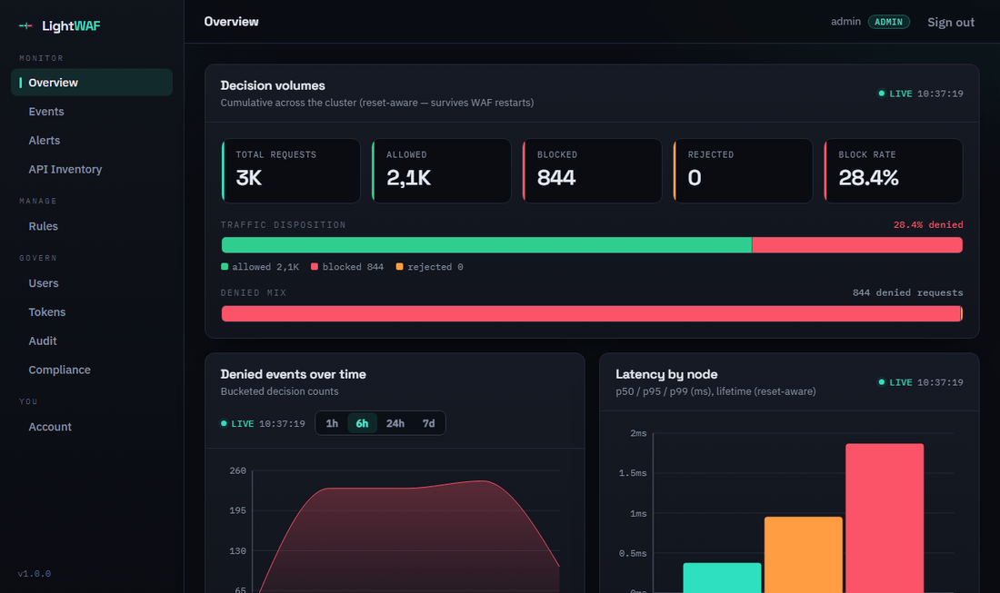

# Light WAF

[](https://github.com/0x00spor3/Light-WAF/actions/workflows/ci.yml)
[](https://crates.io/crates/waf-proxy)
[](https://docs.rs/waf-core)
[](LICENSE)

A Web Application Firewall in **Rust**, running as a **reverse proxy** at Layer 7. It inspects
every HTTP request, applies detection rules, accumulates a CRS-style **anomaly score**, and
decides **Allow / Block (403) / Reject (400 | 429)** before forwarding to the backend.

It runs as a single self-contained binary on one node, and scales out to a cluster with a
**control plane** (dashboard, governed rule management, alerting, SSO, signed audit log,
compliance evidence, SIEM export), **distributed state** over Redis, **managed TLS** (ACME,
mTLS) and **Kubernetes** deployment (Helm charts and an operator).

Goals: *light* (few dependencies, no runtime services required), *fast* (~2 µs inspection,
well under a 1 ms p99 budget), *modular* (every detection is a module toggled from config),
*observable* (structured JSON decision log, Prometheus metrics), *secure by design* (explicit
per-scenario fail-open / fail-closed).

Everything in this repository is open source under the **Apache-2.0** license.

<p align="center">
  
</p>

**Try it in one command** — the WAF, the dashboard and a stream of demo attacks, from the
release images (needs only Docker):

```sh
git clone https://github.com/0x00spor3/Light-WAF && cd Light-WAF/demo && docker compose up
```

Then open <http://localhost:9600> (`admin` / `lightwaf-demo`). See [`demo/`](demo/README.md).

---

## Contents

- [Capabilities](#capabilities)
- [Architecture](#architecture)
- [Quick start](#quick-start)
- [Hardening and performance](#hardening-and-performance)
- [Building and testing](#building-and-testing)
- [Documentation](#documentation)
- [Security](#security) · [Contributing](#contributing) · [License](#license)

---

## Capabilities

### Detection (core)

| Detection | Surface | Notes |
|---|---|---|
| SQLi, XSS, LFI/RFI, SSRF | body/query/cookie | regex content inspection on canonicalized data |
| RCE / command injection | path + body/query/cookie | command injection (incl. in the URL path), expression-language `${@print(…)}`/SpEL, **VBScript/ASP** webshell (`On Error Resume Next`, `Server.*`, `CreateObject`) |
| SQLi (MSSQL procedures) | body/query/cookie | OS-exec stored procedures `xp_cmdshell`/`sp_oacreate`/… invocation-anchored (no FP on prose) |
| LDAP, NoSQL, Mail (SMTP/IMAP), SSTI | body/query/cookie | per-category injection, unambiguous signatures → Critical |
| SSI (Server-Side Includes) | body/query/cookie | `<!--#exec\|include\|printenv\|…` directive → Critical |
| XXE (XML External Entity) | body/query/cookie | `<!ENTITY` / `<!DOCTYPE…SYSTEM` / `encoding="UTF-7"` / external schema → Critical |
| Scanner / tool fingerprint | User-Agent | sqlmap/nuclei/OpenVAS/ffuf/… + OOB domains (Collaborator/interactsh/oast) |
| Path traversal | request line | path + query/cookie/body |
| Header injection (CRLF) | path + headers/query/cookie/body | field-aware; CRLF smuggled in the URL path |
| Request smuggling (CL/TE) | connection | structural framing validation → 400 |
| GraphQL (structural) | body (JSON / `application/graphql` / GET `?query=`) | depth / aliases / fields / directives / batch caps → 400, introspection → 403; opt-in per endpoint |
| gRPC (structural) | body (`application/grpc*`, HTTP/2) | de-frames protobuf → fields inspected by the content modules; size / field-count / nesting caps + compressed-payload policy → 400; opt-in |
| Rate limiting (L7) | connection | token bucket per resolved client IP |

Plus: anti-evasion normalization (double-encoding-aware percent-decode, NFKC, pipeline-wide
overlong-collapse, and a **derived channel** `decode-then-match-then-discard`: base64, HTML-entity
decode, mid-token tag/control-strip, VBScript-concat de-obfuscation), configurable cumulative
scoring, paranoia levels (PL1–4), hot reload (SIGHUP, validate-then-swap), trusted-proxy client-IP
resolution, **TLS termination** (rustls; one port serves HTTP/1.1 and HTTP/2 via ALPN; fail-closed,
no cleartext downgrade), and a **fast path** that skips inspection on provably benign traffic.

**Extensibility (core, all default-off):**

- **WASM plugins** — a [Proxy-Wasm](https://github.com/proxy-wasm/spec) runtime on `wasmi` loads
  `.wasm` filters as modules without forking the core (`[modules.wasm]`); instance pool,
  per-request fuel/memory caps, fail-closed. See [`examples/wasm-plugin/`](examples/wasm-plugin/).
- **OWASP CRS / ModSecurity import** — a `seclang` parser + subset evaluator runs `SecRule` files
  as a module (`[modules.crs]`), with a boot report of unsupported directives.
- **Prometheus metrics** — `/metrics` on a separate loopback listener (`[metrics]`).

### Components (scale, governance, operations)

All opt-in, built on the core's public extension points ([`BOUNDARY.md`](BOUNDARY.md)):

| Area | What you get |
|---|---|
| **Distributed state** | cluster-wide rate limiting and IP reputation over Redis; threat-intel feeds (file/HTTP) |
| **Managed TLS** | hitless ACME certificates (TLS-ALPN-01, DNS-01 via Cloudflare/Route53), shared across nodes; mTLS client auth |
| **Advanced detection** | curated CRS rule pack (CVE/app/evasion signatures), GraphQL and gRPC **schema enforcement**, **OpenAPI positive security**, bot / client-integrity detection, signed WASM plugins (minisign) |
| **Control plane** | web dashboard (overview, events with request drill-down, alerts, API inventory), alerting via webhooks, retention |
| **Rule management** | versioned SecRule rulesets with publish/rollback; a node agent pre-validates and hot-reloads each node |
| **Governance** | RBAC (viewer/operator/admin), local users, service tokens, **OIDC SSO**, tamper-evident **signed audit log** |
| **Compliance & SIEM** | signed SOC 2 / PCI DSS evidence bundles; at-least-once SIEM forwarding (ECS-like NDJSON) |
| **Request capture** | full denied requests (redacted) shipped to the control plane for forensics |
| **Kubernetes** | Helm charts for data plane and control plane; a `WafProxy` operator |

---

## Architecture

```
                   ┌────────────────────────── data plane (per node) ────────────────────────────┐
  client ──HTTP/S──▶  waf  or  waf-enterprise   ────────▶  your backend                          │
                   │    core pipeline + components         (Redis: shared rate limit/reputation) │
                   │        │ decision log, /metrics            ▲                                │
                   │        │                                   │ ruleset + reload               │
                   │        ▼                                   │                                │
                   │   log shipper ─────────┐          waf-node-agent                            │
                   └────────────────────────┼───────────────────▲────────────────────────────────┘
                                            ▼                   │
                                  waf-controlplane (dashboard, API, governance) ── Postgres
                                            └──▶ webhooks, SIEM
```

Five binaries:

| Binary | Role | On the request path? |
|---|---|---|
| `waf` (crate `waf-proxy`) | the core WAF: single node, no external services | yes |
| `waf-enterprise` | the same WAF with every component wired in (Redis state, managed TLS, advanced modules, capture) | yes |
| `waf-controlplane` | telemetry ingest, dashboard + API, governance, alerting, SIEM | no |
| `waf-node-agent` | pulls published rulesets onto a node and triggers a reload | no |
| `waf-operator` | Kubernetes operator for the `WafProxy` resource | no |

### Workspace (19 crates)

**Core** — the datapath. Self-sufficient on one node; never depends on a component.

```
waf-core ────────┐ (base types, no internal dependencies)
   ▲   ▲   ▲  ▲   │
   │   │   │  │   ▼
   │   │   │  └── waf-normalizer   (decode + NFKC + parsing + limits)
   │   │   └───── waf-pipeline     (phased orchestrator + anomaly scoring)
   │   └───────── waf-detection    (modules/rules + ContentPrefilter fast path)
   └───────────── waf-wasm         (Proxy-Wasm runtime on wasmi)
                   ▲
         ┌─────────┴──────────┐
   waf-proxy (bin: waf)   waf-corpus (validation corpus: lib + tests + examples)
```

| Crate | Role |
|---|---|
| `waf-core` | `Config`, `Decision`, `RequestContext`, `Severity`, `Normalized`, the `StateStore` seam; client-IP resolution; `testkit` |
| `waf-normalizer` | percent-decode (double-encoding-aware), NFKC, query/cookie/body parsing, defensive limits |
| `waf-pipeline` | runs modules per phase, accumulates the score, decides the verdict |
| `waf-detection` | the detection modules and their rule tables; `ContentPrefilter`; the CRS engine |
| `waf-wasm` | Proxy-Wasm runtime: `.wasm` filters as `WafModule`s |
| `waf-proxy` | hyper/tokio reverse proxy, TLS, config loading, fail-open/closed, hot reload, `Proxy::builder` |
| `waf-corpus` | ~260 validation cases + runner + metrics — the evidence, not shipped in production |

**Components** — injected through `Proxy::builder` seams, or separate services.

| Crate | Role |
|---|---|
| `waf-state-redis` | Redis `StateStore` (cluster-wide token bucket), reputation store, shared cert store |
| `waf-tls-managed` | ACME (TLS-ALPN-01, DNS-01) with hitless rotation, mTLS verifier |
| `waf-threatintel` | reputation feed writer + IP-reputation module |
| `waf-crs-curated` | curated SecRule content pack |
| `waf-schema-enforcement` | GraphQL/gRPC schema enforcement, OpenAPI positive security, bot detection |
| `waf-wasm-signing` | minisign signature verification for WASM plugins |
| `waf-capture` | denied-request capture and shipping |
| `waf-enterprise` | the data-plane binary wiring all of the above ([README](crates/waf-enterprise/README.md)) |
| `waf-controlplane` | control-plane service + embedded dashboard ([README](crates/waf-controlplane/README.md)) |
| `waf-governance` | RBAC, auth, sessions, signed audit log ([README](crates/waf-governance/README.md)) |
| `waf-node-agent` | per-node ruleset agent ([README](crates/waf-node-agent/README.md)) |
| `waf-operator` | Kubernetes operator (`WafProxy` CRD) |

### Request flow (`waf-proxy/src/lib.rs::handle`)

1. **`build_context`** — resolves the real client IP (trusted proxies / `X-Forwarded-For`).
2. **`run_connection`** — rate limit + request smuggling, **before** parsing → can reject 429/400
   without paying for normalization.
3. **`normalize`** — decode + NFKC + parse; a limit overrun → 400 (per the `[resilience]` policy).
4. **Fast path + inspection** — the prefilter decides whether *any* rule could match; if not, it
   skips inspection (Allow); otherwise the modules run and `score ≥ block_threshold` → 403.
5. **Forward** to the backend, response to the client.

---

## Quick start

### 1. Single node, from source

Requires Rust stable and a backend to protect.

```sh
cargo run --release -p waf-proxy                                  # uses ./config.toml
cargo run --release -p waf-proxy -- --config examples/balanced.toml
```

Config path precedence: `--config` > env `WAF_CONFIG` > `./config.toml`. The default
`config.toml` listens on `0.0.0.0:8080`, forwards to `127.0.0.1:3000`, and runs in
**`mode = "detection-only"`** (logs, does not block); set `mode = "blocking"` to enforce.
[`examples/`](examples/README.md) has ready profiles from *detection-only* to *strict*.

```sh
curl "http://localhost:8080/?q=1%20UNION%20SELECT%20pass%20FROM%20users--"   # watch the decision log
```

An invalid config or missing file exits with code 2. Hot reload via `SIGHUP` is Unix-only.

The component-enabled data plane is `waf-enterprise`, with the same config plus `[enterprise]`
tables — see [`examples/enterprise.toml`](examples/enterprise.toml).

### 2. Full stack locally, with Docker Compose

The quickest way is the [demo](demo/README.md): one `docker compose up`, release images, demo
traffic included. To build the images from your checkout instead, with SSO through a bundled
Keycloak:

```sh
docker compose -f docker-compose.controlplane.yml up --build   # Postgres + Keycloak + control plane → http://localhost:9600
docker compose -f docker-compose.node.yml up --build           # WAF + node agent + log shipper, in front of a demo upstream
```

These stacks are for **local evaluation**: they ship fixed demo credentials as fallbacks.
Override them through a `.env` file before exposing anything.

### 3. Kubernetes

Helm charts for the data plane ([`charts/waf`](charts/waf/README.md)) and the control plane
([`charts/waf-controlplane`](charts/waf-controlplane/README.md)), plus the `WafProxy` operator
([`deploy/operator`](deploy/operator/README.md)). They use the multi-arch release images on
`ghcr.io/0x00spor3` by default (see [`scripts/images/RUNBOOK.md`](scripts/images/RUNBOOK.md) to
build your own). Walkthrough: [`docs/09-kubernetes.md`](docs/09-kubernetes.md).

---

## Hardening and performance

Every guard below is proven with a **bite test**: break the path and the test must go red.
Details in `ARCHITECTURE.md` §11 (performance) and §13 (robustness).

**Inspection latency.** The contract is the latency that depends only on our code
(`enqueue→verdict`), isolated from network and upstream:

- **~2 µs** worst case at PL3 with saturated rules — about **500×** under a **p99 < 1 ms** budget;
- worst-case-set distribution: **p50 ~2.1 µs / p99 ~3.1 µs / p99.9 ~5.3 µs**, with no
  allocation or lock cliff;
- the `max` (~97 µs) is OS scheduler jitter, not a property of the code;
- the CI regression gate is **relative** on a pinned case, so it catches regressions without the
  noise of an absolute threshold on shared runners.

**Resilience** — what the WAF does when *it* is in trouble (per-scenario `[resilience]` policy):

- **upstream down** → declared 502/503, and the WAF **still inspects**: an attack is blocked before
  the dead upstream (upstream down ≠ WAF bypass);
- **corrupt reload** → validate-then-swap: an invalid config is rejected, the last good one stays
  active, **no unprotected window**;
- **panic in a module** → isolated (`catch_unwind`): `fail_open` skips only the broken module,
  `fail_closed` denies. Default `fail_open`: a bug in the WAF must not take the site down.

**Validation.** Detection is measured by a versioned corpus (`waf-corpus`, ~260 cases):
**100% detection recall** on the tracked malicious cases and **0% false positives** at PL3 (a
few documented deferrals aside). Weights and threshold (`critical=6`, `block_threshold=5`) are
justified by that evidence. Detection recall (a rule matches) is distinct from blocking recall
(`score ≥ threshold`).

**Robustness.** Fuzzing of the custom parsers (cargo-fuzz + ASan) and always-on **proptest**
invariants; ReDoS is impossible by construction (linear-time `regex` engine, no backtracking);
differential canonicalization against an independent oracle.

---

## Building and testing

```sh
cargo build --workspace --release
cargo clippy --workspace --all-targets -- -D warnings
cargo test --workspace
cargo test -p waf-corpus --test validation      # the oracle: recall / FP / fast-path equivalence
```

Integration tests that need Postgres or Redis run when `WAF_CP_DATABASE_URL` / `WAF_REDIS_URL` are
set — see [`CONTRIBUTING.md`](CONTRIBUTING.md). The dashboard has a Playwright suite
(`crates/waf-controlplane/ui`, `npm run e2e`).

**Evidence and benchmarks** (runnable reports, not CI tests):

```sh
cargo run -p waf-corpus --example report       # recall/FP per module, score distribution, overlap
cargo run -p waf-corpus --example coverage     # rule → case(s) → min paranoia level
cargo run -p waf-corpus --example tuning       # threshold × paranoia sweep
cargo bench -p waf-corpus                                          # inspection microbenchmark (criterion)
cargo run --release -p waf-corpus --example latency_distribution   # p50/p99/p99.9/max
cargo run --release -p waf-proxy  --example load_overhead          # end-to-end WAF vs passthrough
```

Relative regression gate, on the same machine:

```sh
cargo bench -p waf-corpus --bench inspection -- --save-baseline pinned   # on the base commit
cargo bench -p waf-corpus --bench inspection -- --baseline pinned        # on the candidate
cargo run  -p waf-corpus --example regression_gate                       # PASS / FAIL
```

Coverage-guided fuzzing (`fuzz/`, nightly + Linux) is excluded from the workspace: `bash run_fuzz.sh`.

---

## Documentation

| Document | What it covers |
|---|---|
| [`docs/`](docs/README.md) — Operator Guide | concepts, installation, full configuration, control plane, rule management, governance, compliance & SIEM, operations, Kubernetes |
| [`examples/`](examples/README.md) | ready-to-adapt configurations |
| [`BOUNDARY.md`](BOUNDARY.md) | what is core and what is a component, the extension seams, API stability policy |
| [`ARCHITECTURE.md`](ARCHITECTURE.md) | core design: pipeline, normalization, detection, scoring, performance, robustness |
| [`ARCHITECTURE_ENTERPRISE.md`](ARCHITECTURE_ENTERPRISE.md) | component design: distributed state, managed TLS, extra modules, control plane, governance, SIEM, Kubernetes, request capture |
| [`scripts/*/RUNBOOK.md`](scripts) | per-feature runbooks with copy-paste checks |
| [`CHANGELOG.md`](CHANGELOG.md) | release history |

Where to start reading the code: `crates/waf-proxy/src/lib.rs` (`handle()`, the end-to-end flow),
`crates/waf-pipeline/src/lib.rs` (scoring and verdict), `crates/waf-detection/src/<module>.rs`
(each module's rules).

---

## Security

Please report vulnerabilities — including detection bypasses — privately, as described in
[`SECURITY.md`](SECURITY.md). Do not open public issues for them.

## Contributing

Contributions are welcome; see [`CONTRIBUTING.md`](CONTRIBUTING.md). Commits must be signed off
under the [Developer Certificate of Origin](https://developercertificate.org/) (`git commit -s`), and everyone
taking part follows the [Code of Conduct](CODE_OF_CONDUCT.md).

## License

Apache License, Version 2.0 — see [`LICENSE`](LICENSE) and [`NOTICE`](NOTICE). This covers the
whole repository, core and components alike.
